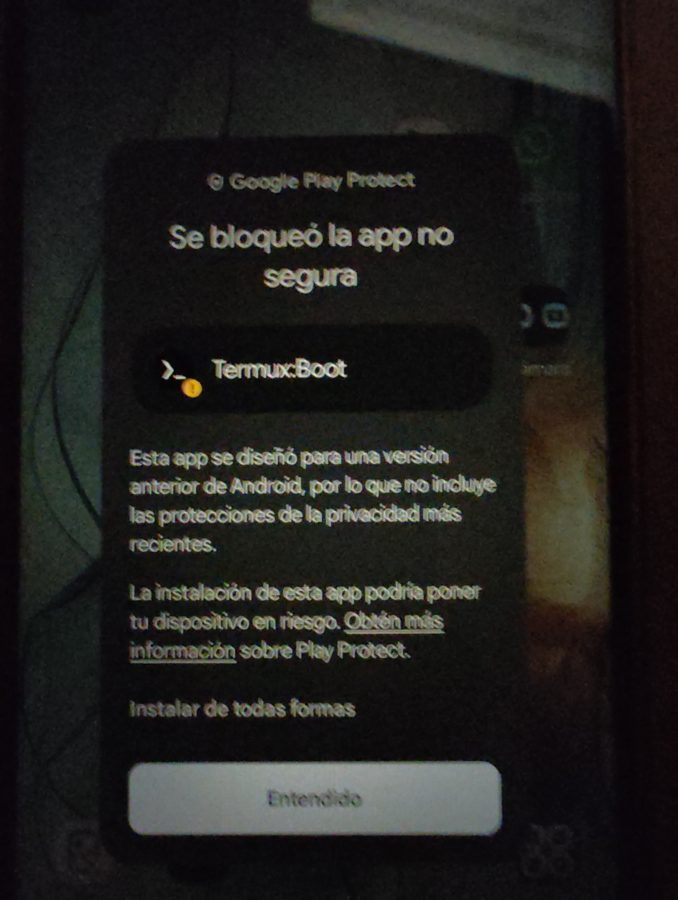

# drawer-server 📱➡️🖥️

**Turn the old phone sitting in your drawer into a small home server, without erasing anything.**

This started as a weekend project to play and learn (with kids watching). An old Android phone is
a surprisingly good server: 8 CPU cores, several GB of RAM, lots of storage, its own battery as a
built-in UPS, and it uses about as much power as a night light.

Everything here is **scripted**. If your phone is similar, clone the repo, plug the phone in, run one
command, and tap a few buttons on the phone when told to. You get the same result without going
through the whole learning process.

## What you get (Path A)

- 🐧 **A small Linux inside the phone** ([Termux](https://termux.dev)), with a package manager.
- ⌨️ **Control from your computer** over SSH (by cable, by Wi-Fi, or from anywhere).
- 🔋 **Stays alive 24/7:** Android won't kill it in the background, and it starts by itself when the phone reboots.
- 🌍 **Access from outside home** with [Tailscale](https://tailscale.com), even on Starlink or other
  connections where opening router ports doesn't work.
- 🧩 Ready for services: Minecraft server, photo backup, media server, scripts and bots… (see [docs/services.md](docs/services.md))

**Path A doesn't unlock, root or erase the phone.** Your apps and photos stay where they are, and
every setting can be reverted (`bash scripts/01-server-settings.sh --revert`, then uninstall the apps).

## Quick start

You need: the phone, a USB cable, a computer (Windows with [Git Bash](https://git-scm.com/download/win), Linux, or macOS), and Wi-Fi.

1. **On the phone:** enable developer options and USB debugging ([how](docs/path-a.md#step-0--look-at-the-phone)).
2. **On the computer:** install Android Platform Tools (`adb`):
   - Windows: `winget install Google.PlatformTools`
   - macOS: `brew install android-platform-tools`
   - Debian/Ubuntu: `sudo apt install adb`
3. Plug the phone in, then:
   ```bash
   git clone https://github.com/ferdeu/drawer-server.git
   cd drawer-server
   bash setup.sh
   ```
4. Do what the purple `[phone]` messages say. If a step fails, fix it and resume with `bash setup.sh <step>`.

Using an AI coding agent? Point it at [AGENTS.md](AGENTS.md) and it can drive the whole thing.

### What the phone will ask you along the way

| Step | What you'll see | What to tap |
|---|---|---|
| 0 | "Allow USB debugging?" | **Always allow from this computer** → Allow |
| 2 | Google Play Protect: *"Blocked unsafe app… built for an older version of Android"* (×3) | the small **"Install anyway"** text, **not** the big "Got it" button ([why](docs/path-a.md#about-the-play-protect-warning)) |
| 3 | Termux opens and text types itself | nothing, just keep the screen unlocked for a few minutes |
| 3 | Recent apps screen | tap the **padlock** under Termux so "Clear all" can't close it ([how](docs/path-a.md#if-the-server-stops-connection-refused)) |
| 5 | Play Store → Tailscale | Install, log in, accept the VPN permission |



## Tested on

| Phone | Android | Result |
|---|---|---|
| Motorola **Moto G24 Power** (XT2425-1, `fogorow`, MediaTek Helio G85, 8 GB RAM) | 14 | ✅ Path A steps 0–5 working |

Path A uses only standard Android features, so it should work on most phones running **Android 11 or newer**.
If you try another phone, please open an issue or PR with your results.

## Docs

- [docs/path-a.md](docs/path-a.md): the step-by-step guide, what each script does and why.
- [docs/concepts.md](docs/concepts.md): the ideas in plain words (adb, Termux, SSH, CGNAT, root…).
- [docs/services.md](docs/services.md): what you can run on it.
- [docs/devices/moto-g24-power.md](docs/devices/moto-g24-power.md): notes for this phone, including "Path B" (custom ROM).

## Status

- [x] Step 0: recon
- [x] Step 1: background-killing settings
- [x] Step 2: Termux from F-Droid
- [x] Step 3: SSH with key login + start on boot
- [x] Step 4: Wi-Fi access + router reservation guide
- [x] Step 5: Tailscale (always-on VPN)
- [ ] Services: ad blocker, Minecraft, photo backup, Jellyfin…
- [ ] Battery care for a phone that's always plugged in

## Repo layout

```
setup.sh              runs every step in order
scripts/              one script per step, run from your computer
termux/bootstrap.sh   runs inside Termux on the phone
docs/                 guides
apks/  local/         created on your machine, not committed
```
