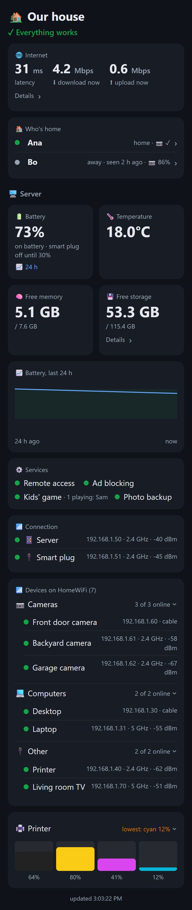

# The status panel: from zero to your own

A web page on the server that tells you, at a glance, whether everything at home works.
Open it from any phone or computer on your Wi-Fi at `http://<server-ip>:8080`, or from anywhere
with Tailscale on at `http://<server-tailscale-ip>:8080` (step 8 prints both addresses).
To open it with one tap, in Chrome's menu choose **Add to Home screen** (on an iPhone, Safari's
**Share** → **Add to Home Screen**): it gets the panel's own icon
(drawn by `scripts/panel-icons.py`; edit it and run step 8 again to change it). It still opens with
the address bar: opening as a full-screen app needs `https`, and the panel is plain `http`.



*Example data. Yours shows your house.*

## What shows up by default

Right after `bash scripts/08-panel.sh`, with an empty `.env`, the page has:

- a line on top: **✓ Everything works**, or what doesn't;
- the **server**: battery and how many watts go in or out, temperature, the processor, memory and
  storage, each with **Details** (24-hour charts for battery and temperature, what each service uses
  for the processor and memory, how the storage is split), and (with the router card) the server's
  own Wi-Fi in its heading;
- **services**: whether remote access is running, plus ad blocking, the game and photo backup once
  you install them. The game also shows who's playing.

Everything else is a **card you switch on** in `.env`. Each card needs something at home; skip the
ones you don't have.

## Cards you can add

| Card | You need | In `.env` |
|---|---|---|
| Name on top | nothing | `PANEL_TITLE="Our house"` |
| Spanish | nothing | `PANEL_LANG=es` |
| Tabs to another panel | another web page you want one tap away (for example a panel on your computer) | `PANEL_TABS="🏡 Home=self,🎒 School=http://192.168.1.200:8765/\|http://school-pc:8765/"`: `self` is this panel; for the others, the address at home, then the Tailscale one. Opened by a home address, the tab links to the first, otherwise to the second (so the cameras keep working at home) |
| 🛰️ Internet | a Starlink dish | `PANEL_STARLINK=yes` |
| 🚀 Speed test | nothing; each test moves ~100 MB, mind data caps | `PANEL_SPEEDTEST=4`: tests a day, 0 to 6 (0 = only the "Test again" button) |
| 🏠 Who's home | each person's phone with a fixed IP in the router | `PANEL_PEOPLE="Ana=192.168.1.20,Bo=192.168.1.21"` (simple names: letters, numbers, - or _) |
| 📶 Devices on the Wi-Fi | a TP-Link router (tested: Archer AX23) | `PANEL_ROUTER=tplink`, `ROUTER_URL`, `ROUTER_PASSWORD` |
| Device names | the router card | nothing: tap a device in the panel to name it (from home). Or `PANEL_DEVICE_NAMES="F4-70-18-00-00-01=Front door camera,…"` |
| Hide devices | the router card | `PANEL_DEVICE_HIDE="F4-70-18-00-00-03,…"`, e.g. a camera's Wi-Fi you turned off because it's on cable (otherwise it shows as an offline camera for a month) |
| 🖨️ Ink levels | an Epson printer with a fixed IP | `PANEL_PRINTER_IP=192.168.1.40` |
| 📷 Photo backup | step 9, run with the same name as in `PANEL_PEOPLE` | nothing: step 9 adds it |
| 🔌 Smart plug | step 10, and a fixed IP for the plug in the router | nothing: step 10 adds its own card to the server section (on or off; under Details, its rule and Wi-Fi). Optional `CHARGE_LOW` / `CHARGE_HIGH` (default 30 and 80) |
| 📷 Cameras | step 11, and cameras with RTSP and fixed IPs | `PANEL_CAMERAS="Front=192.168.1.50:ABCDEF,…"`, then `bash scripts/11-cameras.sh` (not step 8) |
| 🎞️ Recordings | step 12 (motion clips) | nothing: a line in the cameras card, "off" until step 12 records. `PANEL_RECORDINGS=no` hides it |
| 💾 Disk split | nothing | the storage card gets a **Details** line showing how the space is shared. Optional `DISK_RECORDINGS_GB`, `DISK_BACKUP_GB`, `DISK_BACKUP_PAUSE`, `DISK_KEEP_FREE_GB` |

## Step by step

1. **Run steps 0–5 first** (`bash setup.sh`), so the server is on the Wi-Fi with a fixed IP.
2. **Give fixed IPs** in your router to the phones in "who's home" and to the printer, the same
   way you did for the server in step 4. Write down which IP is whose. (With a TP-Link router and
   the devices card on, you can also do it later from the panel, see step 5.)
3. **Fill `.env`**. A full example:
   ```bash
   PANEL_LANG=en
   PANEL_TITLE="Our house"
   PANEL_STARLINK=yes
   PANEL_PEOPLE="Ana=192.168.1.20,Bo=192.168.1.21"
   PANEL_ROUTER=tplink
   ROUTER_URL=http://192.168.1.1
   ROUTER_PASSWORD=the-one-you-use-to-log-into-the-router
   PANEL_PRINTER_IP=192.168.1.40
   ```
4. **Run** `bash scripts/08-panel.sh` and open the address it prints.
5. **Name the devices.** The devices card lists everything on the Wi-Fi with the name each device
   reports, and some report none (you'll see an address like `192.168.1.50` instead). From home,
   tap a device, type a name and tap **Save**; an empty name goes back to the reported one. A device
   that's offline also gets **Delete from the list** (it asks first): the panel forgets it and its
   name, and if it joins again it shows up as new. Names live on the server
   (`~/.config/drawer-server/device-names-panel.json`) and move with it to a new phone.

   You can also set names in `.env`: copy MACs into `PANEL_DEVICE_NAMES` and run step 8 again.
   Names given in the panel win over those, and both win over the reported ones. Phones often make
   up a new MAC for each network (and some change it now and then), so a phone's name may not stick.

   **Fix an IP.** Tapping a device also shows its IP and whether it's fixed ("Fixed IP 192.168.1.40 ✓").
   A connected device without one gets **📌 Fix the IP …** (from home; it asks first): the router
   keeps the address the device has right now for it from then on, so nothing changes today. Do it
   for anything you reach by address, like the printer, the cameras or a computer. A device whose
   IP is set on the device itself gets no button (the router doesn't lend it one). People's phones
   and the plug don't show in this list: fix theirs in the router's page. Unfixing stays there too,
   so a camera can't lose its address by a wrong tap.

   To see everything the router knows first, run `bash scripts/router-devices.sh`. It needs the
   router password from `.env` and changes nothing. It prints one line per device (MAC, the name it
   reports, its IP and whether it's fixed, cable or Wi-Fi band, access point, signal, how long it's
   been online or when it was last seen, traffic) and the panel group it will land in. The full detail
   goes to `local/router-devices.json`.
6. Later, **steps 9, 10, 11 and 12** add photo backup, the smart plug, the cameras and the recordings to the page by
   themselves (they restart the panel). Run step 9 with the person's name exactly as in `PANEL_PEOPLE`
   (`bash scripts/09-syncthing.sh Ana`) so their backup shows under them.

Until everything is set up, a line at the bottom of the page lists what can still be added
("➕ Can be added: printer ink, Starlink… (how)", linking here). It goes away once there's nothing left,
or with `PANEL_ADDABLE=no` in `.env` (for things you don't have, like a Starlink dish).

To change anything later (a name, a person, a new card), edit `.env` and run
`bash scripts/08-panel.sh` again. It takes a few seconds and keeps the battery history.

## How each card works

| Card | How it gets the data |
|---|---|
| 🛰️ Internet | the dish's local gRPC API at `192.168.100.1:9200` (`grpcurl`), no account needed. Shows latency and the download/upload **in use right now**, which is not a speed test. |
| 🏠 Who's home | pings each phone every 2 min; "home" if it answered in the last 20 min (sleeping phones skip pings). With the router card on, a phone the router lists as connected also counts as home, and tapping a person shows their phone's Wi-Fi and photo backup, and that phone leaves the devices list. |
| 📶 Devices | asks the TP-Link router (web API, [tplinkrouterc6u](https://github.com/AlexandrErohin/TP-Link-Archer-C6U)) every 5 min for everything connected, grouped by type, with cable/2.4/5 GHz and signal. Devices that leave show as offline for a month, and one that joins the Wi-Fi but never gets an address is flagged (a common reason cameras "go offline"). Tap a device to name it, fix its IP (the router keeps its current address for it), or delete an offline one from the list; only from home and from the panel's own page. It also reads which IPs are fixed. |
| 🖨️ Ink | Epson's own SNMP status query (`@BDC ST2`), which works on old models like the XP-211 that don't fill the standard printer-supplies table. |
| 📷 Photo backup | Syncthing's local API: whether each phone is connected, how much is left, the download speed. Folders from phones that aren't in `PANEL_PEOPLE` get a card of their own. |
| 🔌 Smart plug | the panel itself switches the plug: it checks every minute, cuts the charger at 80% and turns it back on at 30% (`CHARGE_HIGH` and `CHARGE_LOW`). If the battery can't be read for 30 minutes it turns the charger on, and the plug comes back on after a power cut, so a glitch ends with a full battery, never a flat one. It talks to the plug over the home network only. |
| 🚀 Speed test | [speedtest-go](https://github.com/showwin/speedtest-go) (a Termux package) against the nearest speedtest.net server: 10 s down, 15 s up, ~100 MB. It runs on the server, so the server's own Wi-Fi is part of the result: on 2.4 GHz it can't show more than about two thirds of the link speed, even if the internet is faster. The last result stays on the card, the last 24 h under Details. "Test again" works only from the panel's own page and waits 5 minutes between tests. |
| 📷 Cameras | home only, decided by the address the request comes from (Tailscale counts as away). For each camera the panel runs one ffmpeg that decodes only full frames from go2rtc's small stream, so a new still arrives with each full frame the camera sends (every ~4 s on the tested cameras); it starts when someone opens the page and stops 30 s after the last request. The first still takes a few seconds. Tapping a camera opens live video, which the panel passes through from go2rtc (it only listens on the phone); if the screen can't play the big stream within 5 s, it switches to the small one. |
| 🎞️ Recordings | a line at the bottom of the cameras card, with the clips step 12 saved in `~/recordings`. Without step 12 and with no clips it just says "off". It is **closed by default** and loads nothing until you open it. Then: pick a camera, a day (today first), and tap a thumbnail to play the clip full screen, with ◀ ▶ for the previous or next clip. Seeking works. Some browsers can't play H.265 video: then it says "This browser can't play these videos (H.265)." and offers a **Download** link. The clips show only at home (like live video). Away from home it says "Home only: open … on the home Wi-Fi". `PANEL_RECORDINGS=no` hides it for everyone and the clips can't be reached by address either. **Deleting:** 🗑️ in the player deletes that clip, and "Delete the whole day" under the days deletes one camera's day (it says how many clips and how much space, and asks twice). Anyone at home can do it, after the question, and nothing brings a clip back. A clip still being recorded is never deleted. The panel can't change settings. |
| 💾 Free storage | free space, and under **Details** one row per kind of file: `Photo backup 20 / 50 GB (40%)`, `Recordings 3.1 / 10 GB (31%)`, then `Free`. A kind with no share set shows only its size. Photo backup comes from Syncthing, recordings from the recorder. With `DISK_BACKUP_GB` set, the top line says "photo backup near its limit" over 90% of it, and with `DISK_BACKUP_PAUSE=yes` the panel pauses the photo backup folders at 100% ("photo backup paused: at its limit") and resumes them under 95%. It only resumes folders it paused itself, and never deletes a photo. Recordings at their share give **no** warning: the oldest clip is deleted instead. |
| 📊 Processor | how hard the phone is working: each group of cores' speed right now against its top speed, averaged over the last 10 s. Android doesn't let apps read the processor's real use, its temperature sensors or the network totals, so this is the closest it gets without root. **Details** lists each of our own services' share of the whole processor; helpers like ffmpeg count under the service that started them, and "Other" is the rest of what Termux runs. Other apps and Android itself can't be seen. |
| 🧠 Memory | free RAM out of the total. **Details** lists the memory each of our own services holds, biggest first, then "Android and the rest" (everything else in use). |
| 🔋 Watts | the battery's voltage times its current, from Termux:API: "using 0.3 W" on battery, "charging at 12 W" on the charger. |
| ⚠️ Top line, recorder | "⚠️ Front looks obstructed, check it (still recording)" or "(recording paused)", "Front not recording" (the recorder can't see that camera), "recorder stopped" (the panel hasn't heard from it for a minute) and "Disk almost full: recording stopped". They clear by themselves. |

When the recorder runs, the camera stills come from the recorder's own picture check instead of a second ffmpeg per camera, which saves CPU. If the recorder is off or restarting, the panel makes the stills itself, as before.

Every section folds from its heading (tap it, or Tab to it and press Enter). Folded, the heading shows a
one-line summary, like `🔋 47% · 23.0 °C · processor 35%` for the server, and a folded Cameras section
loads no pictures. Problems still show in the top line. The printer starts folded, the rest open. What's
folded or open (sections, each Details, each person, each group of devices) is remembered on each browser.

On a computer or tablet the page uses more width: the internet numbers sit in one row, who's home and
photo backup side by side, and the server's cards in one row (three per row on mid-size screens).

## Fridge tablet

A second page for a tablet that stays on all day, lying sideways (tested size: an 11" tablet,
2000×1200). Open `https://<server-ip>:8443/fridge` in Chrome on the tablet (step 8 prints it), after
trusting the home certificate once (below). Use the number, not a name: the page's data is only given
to an address typed as an IP. (`http://<server-ip>:8080/fridge` works too, but there Spotify only
shows what plays and the screen may turn off.) It has four screens; swipe sideways or tap the dots
at the bottom:

- **Home**: a big clock and date, what's left of today in your calendars (an event in progress says
  **NOW**), and at the bottom the Spotify strip (below).
- **Cameras** (step 11): one camera big and live, the others as stills; tap a small one to make it
  the big one. Tap the big one for the whole screen: pinch to zoom, drag to look around, ✕ (or a
  tap while not zoomed) to go back. Home only, like in the panel.
- **Calendar**: today and the next six days.
- **Status**: internet, who's home, ink, the server, storage and the devices on the Wi-Fi, from
  the same data as the panel.

After 2 minutes without a touch it goes back to Home (`FRIDGE_BACK_S`). To stay on the cameras or
any other screen instead, untick *Always back to Home* under the date (each tablet remembers its
own choice). To be kind to a screen
that never turns off, the background is black, everything moves a few pixels every few minutes,
and between midnight and 7 the page dims itself (`FRIDGE_DIM=00:00-07:00`).

**Calendars.** Each Google calendar has a *secret address in iCal format* (Google Calendar on a
computer → the calendar's ⋮ → **Settings and sharing**). Only its owner, or someone who can manage
it, sees that address, so each person copies their own. Put one line per calendar in `.env`, with
a name and a color, always inside double quotes, and run step 8:

```bash
FRIDGE_CAL_1="Home|#5ee1ff|https://calendar.google.com/calendar/ical/…/basic.ics"
FRIDGE_CAL_2="Kid one|#4285f4|https://calendar.google.com/calendar/ical/…/basic.ics"
```

The server reads them every 10 minutes. If the internet is down it keeps showing the last copy,
with a small "no connection to the calendar" line. The addresses are secrets: anyone with one can
read that calendar, so they stay in `.env` and on the server, never on the page.

**Spotify.** The tablet becomes a Spotify speaker called *Fridge* (*Heladera* in Spanish): plug a
Bluetooth speaker into the tablet and play music from the page itself. The strip at the bottom of
Home shows what the account is playing on any device, with back, pause and next; while it plays
somewhere else, **Play here** brings it to the tablet. The magnifier opens a search screen: what was
played lately and the account's playlists, or type a song, artist, album or playlist and tap it.
A song keeps playing the rest of its album.

Some tablets can't play Spotify from a browser: a song sounds for about ten seconds and goes quiet,
or the page skips through several songs in a second (a *Lenovo Tab M7* does this: its copy-protection
component, *Widevine*, is the limited kind, which the "DRM Info" app shows as level **L3**). The
page can then send the music to the **Spotify app** on the tablet instead, which plays fine: install
the app, log in with the same account, and put `FRIDGE_SPOTIFY_PLAYER=app` in `.env` (step 8). The
strip, the buttons and the search stay the same; only the app makes the sound, so it must be open
(in the background is enough). When the page can't see it, the strip says so. `app` looks for the
account's tablet; if another tablet uses the same account, or the strip keeps asking to open the
app while it is open, put the tablet's name as Spotify shows it instead
(`FRIDGE_SPOTIFY_PLAYER="Lenovo TB-7306X"`). Any speaker's name works the same way.

It needs a Spotify **Premium** account (a family-plan member counts) and a free app made with that
account at [developer.spotify.com](https://developer.spotify.com/dashboard): any name, redirect URI
`http://127.0.0.1:8888/callback`, "Web API". Put its Client ID and Client secret in `.env` as
`SPOTIFY_CLIENT_ID` and `SPOTIFY_CLIENT_SECRET`, then run `bash scripts/spotify-login.sh` on your
computer and accept in the browser that opens; the page shows which account is accepting, so check
it's the right one. Logged in before these features came? Run it again to allow them. The page gets
an access token that lasts an hour, only at home and only over https; the client secret and the
login stay on the server.

**The home certificate (once per tablet).** Spotify only plays inside `https` pages, and a page
can only keep the screen on there. Step 8 makes a home certificate on your computer
(`local/https/`, never shared) and gives the server an https address signed by it. Teach the tablet
to trust it:

1. Get the certificate onto the tablet as a file: step 8 leaves it at `local/home-ca.pem` on your
   computer. Put **only that file** in your Google Drive (or email it to yourself) and download it on
   the tablet; never share anything from `local/https/`, it holds the keys.
   Keep the `.pem` ending: Android's Chrome hands `.crt` files to an installer that refuses home
   certificates, so nothing lands in Downloads. The server also offers it at
   `http://<server-ip>:8080/ca.crt`, but Chrome often switches what you type to https (which that
   port doesn't speak), and it won't download anything from a page past a certificate warning.
2. Settings → tap the magnifier and search **certificate** → **CA certificate** (on Android 11 it
   hides under *Security* → *Advanced* → *Encryption & credentials* → *Install a certificate*) →
   *Install anyway* → pick `home-ca.pem`. Android may ask you to set a screen lock first. If the
   picker ignores the file when you tap it, name it `home-ca.crt` instead: once you are picking it
   from here, that name works. (With the tablet's USB debugging on, `MSYS_NO_PATHCONV=1 adb push
   local/home-ca.pem /sdcard/Download/home-ca.crt` puts it there; the first part keeps Git Bash on
   Windows from mangling the tablet path. If `adb devices` lists more than one, add `-s <serial>`.)
3. Check it's yours: *Encryption & credentials* → *Trusted credentials* → **User** → tap it. Its
   SHA-256 fingerprint must match the *Home certificate SHA-256* line step 8 prints (the file went
   through other places on its way). If not, remove it.
4. Open `https://<server-ip>:8443/fridge`: no warning. In Chrome's ⋮ menu, *Install* (or *Add to
   Home screen* → *Install*) gives it its own icon that opens full screen, with no browser bars.
   To keep it there, turn on Settings → Security → *App pinning* and pin it from the recent apps
   screen; with gesture navigation, swipe up and hold to unpin.

The home certificate can only vouch for home addresses (192.168…, 10…, 172.16–31…), never for a
website, so even someone who stole its key from your computer couldn't pass off a fake bank or
Google page to the tablet. Its key never leaves your computer. The server's own certificate lasts a year; step 8 makes a new one before it runs out
(run step 8 at least once a year) or when the server's IP changes, and the tablet needs nothing new.
Without step 2 the page still opens after Chrome's warning, but Chrome forgets that choice after
about a week and the page stops getting data until someone accepts it again.

**Keeping the screen on.** Over `https` the page asks Chrome to keep the screen on while it is open.
If the tablet restarts, tap the icon again. (A kiosk app like Fully Kiosk Browser can also do it and
start on boot; it is not needed.) If the tablet has a battery-protection mode (Lenovo's stops
charging around 60–80%), turn it on, since it will be plugged in for good; otherwise a second smart
plug can keep it between 30 and 80%.

## Tips

- **Grouping:** cameras are recognized by brand (Ezviz/Hikvision) or by a name containing *cam*,
  *doorbell* or *timbre*; computers by *desktop*, *laptop*, *notebook*, *pc*…; phones by *phone*,
  *iphone*, *galaxy*, *pixel*… So `Front door camera` lands in Cameras.
- **TP-Link allows one admin at a time.** Every 5 minutes the panel logs in, which logs out a browser
  open on the router page. If the router page keeps kicking you out, that's why; it's harmless.
- The router password is copied to the server only (readable by Termux alone), never put in a command line.
