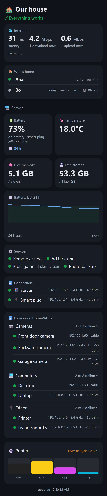

# The status panel: from zero to your own

A web page on the server that tells you, at a glance, whether everything at home works.
Open it from any phone or computer on your Wi-Fi at `http://<server-ip>:8080`, or from anywhere
with Tailscale on at `http://<server-tailscale-ip>:8080` (step 8 prints both addresses).



*Example data. Yours shows your house.*

## What shows up by default

Right after `bash scripts/08-panel.sh`, with an empty `.env`, the page has:

- a line on top: **✓ Everything works**, or what doesn't;
- the **server**: battery with a 24-hour chart, temperature, free memory and storage;
- **services**: whether remote access is running, plus ad blocking, the game and photo backup once
  you install them. The game also shows who's playing.

Everything else is a **card you switch on** in `.env`. Each card needs something at home; skip the
ones you don't have.

## Cards you can add

| Card | You need | In `.env` |
|---|---|---|
| Name on top | nothing | `PANEL_TITLE="Our house"` |
| Spanish | nothing | `PANEL_LANG=es` |
| 🛰️ Internet | a Starlink dish | `PANEL_STARLINK=yes` |
| 🏠 Who's home | each person's phone with a fixed IP in the router | `PANEL_PEOPLE="Ana=192.168.1.20,Bo=192.168.1.21"` (simple names: letters, numbers, - or _) |
| 📶 Devices on the Wi-Fi | a TP-Link router (tested: Archer AX23) | `PANEL_ROUTER=tplink`, `ROUTER_URL`, `ROUTER_PASSWORD` |
| Device names | the router card | `PANEL_DEVICE_NAMES="F4-70-18-00-00-01=Front door camera,…"` |
| 🖨️ Ink levels | an Epson printer with a fixed IP | `PANEL_PRINTER_IP=192.168.1.40` |
| 📷 Photo backup | step 9, run with the same name as in `PANEL_PEOPLE` | nothing: step 9 adds it |
| 🔌 Smart plug | step 10, and a fixed IP for the plug in the router | nothing: step 10 adds it to the battery card. Optional `CHARGE_LOW` / `CHARGE_HIGH` (default 30 and 80) |
| 📷 Cameras | step 11, and cameras with RTSP and fixed IPs | `PANEL_CAMERAS="Front=192.168.1.50:ABCDEF,…"`, then `bash scripts/11-cameras.sh` (not step 8) |

## Step by step

1. **Run steps 0–5 first** (`bash setup.sh`), so the server is on the Wi-Fi with a fixed IP.
2. **Give fixed IPs** in your router to the phones in "who's home" and to the printer, the same
   way you did for the server in step 4. Write down which IP is whose.
3. **Fill `.env`**. A full example:
   ```bash
   PANEL_LANG=en
   PANEL_TITLE="Our house"
   PANEL_STARLINK=yes
   PANEL_PEOPLE="Ana=192.168.1.20,Bo=192.168.1.21"
   PANEL_ROUTER=tplink
   ROUTER_URL=http://192.168.1.1
   ROUTER_PASSWORD=the-one-you-use-to-log-into-the-router
   PANEL_PRINTER_IP=192.168.1.40
   ```
4. **Run** `bash scripts/08-panel.sh` and open the address it prints.
5. **Name the devices.** The devices card lists everything on the Wi-Fi with the name each device
   reports, and some report none (you'll see a MAC address like `F4-70-18-…` instead). Copy those
   MACs into `PANEL_DEVICE_NAMES` with a name you recognize, and run step 8 again.
   Names you set there win over the reported ones.

   To see everything the router knows first, run `bash scripts/router-devices.sh`. It needs the
   router password from `.env` and changes nothing. It prints one line per device (MAC, the name it
   reports, its IP and whether it's fixed, cable or Wi-Fi band, access point, signal, how long it's
   been online or when it was last seen, traffic) and the panel group it will land in. The full detail
   goes to `local/router-devices.json`.
6. Later, **steps 9, 10 and 11** add photo backup, the smart plug and the cameras to the page by
   themselves (they restart the panel). Run step 9 with the person's name exactly as in `PANEL_PEOPLE`
   (`bash scripts/09-syncthing.sh Ana`) so their backup shows under them.

To change anything later (a name, a person, a new card), edit `.env` and run
`bash scripts/08-panel.sh` again. It takes a few seconds and keeps the battery history.

## How each card works

| Card | How it gets the data |
|---|---|
| 🛰️ Internet | the dish's local gRPC API at `192.168.100.1:9200` (`grpcurl`), no account needed. Shows latency and the download/upload **in use right now**, which is not a speed test. |
| 🏠 Who's home | pings each phone every 2 min; "home" if it answered in the last 20 min (sleeping phones skip pings). With the router card on, a phone the router lists as connected also counts as home, and tapping a person shows their phone's Wi-Fi and photo backup, and that phone leaves the devices list. |
| 📶 Devices | asks the TP-Link router (web API, [tplinkrouterc6u](https://github.com/AlexandrErohin/TP-Link-Archer-C6U)) every 5 min for everything connected, grouped by type, with cable/2.4/5 GHz and signal. Devices that leave show as offline for a month, and one that joins the Wi-Fi but never gets an address is flagged (a common reason cameras "go offline"). |
| 🖨️ Ink | Epson's own SNMP status query (`@BDC ST2`), which works on old models like the XP-211 that don't fill the standard printer-supplies table. |
| 📷 Photo backup | Syncthing's local API: whether each phone is connected, how much is left, the download speed. Folders from phones that aren't in `PANEL_PEOPLE` get a card of their own. |
| 🔌 Smart plug | the panel itself switches the plug: it checks every minute, cuts the charger at 80% and turns it back on at 30% (`CHARGE_HIGH` and `CHARGE_LOW`). If the battery can't be read for 30 minutes it turns the charger on, and the plug comes back on after a power cut, so a glitch ends with a full battery, never a flat one. It talks to the plug over the home network only. |
| 📷 Cameras | home only, decided by the address the request comes from (Tailscale counts as away). For each camera the panel runs one ffmpeg that decodes only full frames from go2rtc's small stream, so a new still arrives every ~2.5 s; it starts when someone opens the page and stops 30 s after the last request. The first still takes a few seconds. Tapping a camera opens live video, which the panel passes through from go2rtc (it only listens on the phone); if the screen can't play the big stream within 5 s, it switches to the small one. |

What's folded or open (the chart, each person, each group of devices) is remembered on each browser.

## Tips

- **Grouping:** cameras are recognized by brand (Ezviz/Hikvision) or by a name containing *cam*,
  *doorbell* or *timbre*; computers by *desktop*, *laptop*, *notebook*, *pc*…; phones by *phone*,
  *iphone*, *galaxy*, *pixel*… So `Front door camera` lands in Cameras.
- **TP-Link allows one admin at a time.** Every 5 minutes the panel logs in, which logs out a browser
  open on the router page. If the router page keeps kicking you out, that's why; it's harmless.
- The router password is copied to the server only (readable by Termux alone), never put in a command line.
