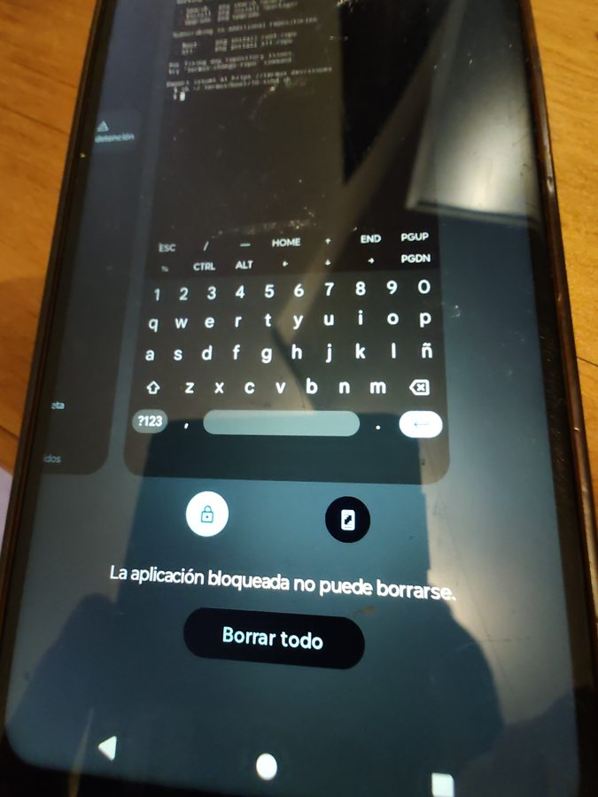

# Path A: server on stock Android (nothing erased)

`bash setup.sh` runs steps 0–8 for you; steps 9 to 11 are separate commands. This page explains what each step does, so you know what's
happening and can fix it if something goes wrong.

**Why "Path A"?** There are two ways to turn a phone into a server:

- **Path A** (this one): keep the phone's normal Android and add a Linux environment on top (Termux).
  No unlocking, no erasing, low risk. Limits: no "root" (admin) access, so programs can't use ports
  below 1024 (for example DNS on port 53), and you can't cap battery charging from software.
- **Path B**: unlock the bootloader and install a different system (like LineageOS) plus root. Full
  control, but it erases the phone, may void the warranty, and on some phones it's risky or impossible.
  See the notes for your device in [devices/](devices/).

Start with A. You can always go to B later.

---

## Step 0: look at the phone

`scripts/00-recon.sh` (read-only)

On the phone:

1. **Settings → About phone** → tap **Build number** 7 times. Enter your PIN. "You are now a developer!"
2. **Settings → System → Developer options** → turn on **USB debugging**.
   Developer options being on is *not* enough: USB debugging is a separate switch inside that menu.
3. Plug the phone into the computer. On the phone: **"Allow USB debugging?"** → check
   *Always allow from this computer* → **Allow**.

"File transfer" mode is not the same thing: it only lets the computer see files, like a USB stick.
`adb` needs USB debugging.

The script prints the model, Android version, RAM, storage and battery. If `adb devices` shows nothing,
toggle USB debugging off and on, tap **Revoke USB debugging authorizations**, and replug the cable.

## Step 1: stop Android from killing background programs

`scripts/01-server-settings.sh` (undo with `--revert`)

Android is built for a phone in your pocket: it kills anything in the background to save battery.
A server must never sleep, so the script:

- turns off the **phantom process killer** (Android 12+ kills "child processes" of apps, and every
  program you run inside Termux is one of those). This is the same as *Developer options →
  Disable child process restrictions*.
- turns off **Adaptive Battery**, which freezes apps you don't open often.

## Step 2: install Termux

`scripts/02-install-termux.sh`

Downloads three apps from **F-Droid** (the free-software app store) and installs them:

| App | What it is |
|---|---|
| **Termux** | a terminal with a small Linux inside, where the server programs live |
| **Termux:Boot** | starts our server automatically when the phone turns on |
| **Termux:API** | lets scripts read battery level, temperature, etc. |

The Play Store version of Termux is old and abandoned. Always use F-Droid (or GitHub releases).
All three must come from the same place, or they refuse to talk to each other.

The script also removes the three apps from battery optimization.

### About the Play Protect warning

You will see this three times (photo from a phone set to Spanish):


> **Blocked unsafe app.** *This app was built for an older version of Android and doesn't include the
> latest privacy protections.*

Tap the small **"Install anyway"** text. The big **"Got it"** button *cancels* the install.

**Why it appears:** Termux deliberately targets an older Android version, because newer Android
versions forbid apps from running programs they download (and running programs is exactly what
Termux is for). Play Protect flags *that*, not a virus. Termux is open source and the APKs come
straight from f-droid.org.

## Step 3: SSH

`scripts/03-setup-ssh.sh`

**SSH** lets you type commands on the phone from your computer's keyboard, as if you were sitting at it.

1. Creates a key pair on your computer (`~/.ssh/drawer_server_ed25519`). Think of it as a
   key-and-lock set: the computer keeps the key, the phone gets the lock.
2. Copies the lock (public key) and `termux/bootstrap.sh` to the phone's `Download/drawer-server/` folder.
3. Opens Termux and **types** `bash /sdcard/Download/drawer-server/bootstrap.sh` for you.
   **Leave the phone unlocked and on Termux.** The first launch unpacks Linux, so the script waits ~25 s.
4. Inside the phone, the bootstrap installs `openssh`, trusts only your key (password login is off),
   holds a *wake lock* so the CPU doesn't sleep, and creates `~/.termux/boot/10-sshd.sh` so SSH comes back after a reboot.
5. Tests SSH through the USB cable.

Termux's SSH listens on port **8022**, not 22, because ports under 1024 need root.
The Termux username looks like `u0_a123`; it gets saved in `local/phone.env`.

You'll see a permanent notification "Termux: wake lock held". That's how you know it's awake.

## Step 4: home network

`scripts/04-network.sh`

Tests SSH over Wi-Fi (no cable) and tells you what to put in your router so the phone always gets the
same address. That's a **DHCP reservation**: the router hands out addresses like a coat check, and the
reservation tells it "this phone always gets ticket 50".

On a **TP-Link Archer AX23** (tested): *Advanced → Network → DHCP Server → Address Reservation → Add*, type the MAC in the six boxes and the IP, then press **Tab** (the SAVE button stays grey until the IP field loses focus).

About the MAC address: Android invents a different one for each Wi-Fi network (privacy feature), but it
stays the same for *your* network, so reserving the one the script shows works fine.

Weak signal (below about −75 dBm) means a flaky server. Move the phone closer to the router.

## Step 5: Tailscale (access from anywhere)

`scripts/05-tailscale.sh`

From outside home, the usual trick is "open a port on the router". That doesn't work on **Starlink**
and many mobile/fiber providers, because they put lots of homes behind one public address (**CGNAT**),
so nobody outside can reach yours directly.

**Tailscale** creates a private network between your devices that works from anywhere, and it's free
for personal use. The script opens the Play Store for you. Install it, log in, and accept the VPN
permission. Then install Tailscale on your computer or other phone with the same account.

The script also sets Tailscale as the **always-on VPN**, so it reconnects after a reboot. The phone needs a Google account signed in to install from the Play Store.

**After step 5 the server is done.** Steps 6–11 add things to do with it. They work over Wi-Fi, so
you can unplug the cable, and each one is optional. They read their settings from `.env`
(copy `.env.example` to `.env`; each section there says which step uses it).

---

## Step 6: ad blocking for the whole home (optional)

`scripts/06-nextdns.sh`, needs `NEXTDNS_LINK_URL` in `.env` (skips itself without it)

Blocks ads and trackers on every device at home, including TVs and the kids' tablets.
The blocking runs in [NextDNS](https://nextdns.io)'s cloud, because without root Android won't let
the phone answer DNS on port 53, the only port home routers use for it. What the phone does is keep
NextDNS up to date with your home's public IP, which changes often on Starlink and other CGNAT
connections.

1. Create a free account at my.nextdns.io. In **Setup → Linked IP → Show advanced options**, copy the
   URL that looks like `https://link-ip.nextdns.io/…/…` into `.env` as `NEXTDNS_LINK_URL`.
2. Run the script.
3. In your router's DHCP settings, set primary DNS `45.90.28.40` and secondary `45.90.30.40`
   (the script prints them too).

The free plan covers 300,000 queries a month. A busy home can go over that; NextDNS's dashboard shows
how much you use. To undo, remove those two DNS servers from the router.

## Step 7: game server for the kids (optional)

`scripts/07-luanti.sh`, needs `LUANTI_ADMIN` in `.env` (skips itself without it)

[Luanti](https://www.luanti.org) with the Mineclonia game: free, open source and plays like
Minecraft. It runs inside a small Debian on the phone and uses ~300 MB of RAM. Put the player name
that will be the game's admin in `.env` as `LUANTI_ADMIN` (yours or a kid's). The first run takes a
few minutes. Players install Luanti (free on Android, Windows, macOS and Linux), pick **Join Game**
and type the server's IP and port `30000`. Details in [services.md](services.md#luanti-notes-from-the-test).

## Step 8: status panel

`scripts/08-panel.sh`, optional `PANEL_*` settings in `.env`

A web page with the server's health and, if you want, your home's: internet, who's home, devices
on the Wi-Fi, printer ink. Open `http://<server-ip>:8080`. How to set up each card: [panel.md](panel.md).

## Step 9: photo backup from the family's phones (optional)

`bash scripts/09-syncthing.sh <name>`, once per person, with their phone at hand. Use the same name
as in the panel's `PANEL_PEOPLE` (same capitals; letters, numbers, - or _) so the backup shows under that person.

Each family phone sends its camera folder to the server over the home Wi-Fi with
[Syncthing](https://syncthing.net). The server keeps every photo, even after it's deleted on the phone.

**Before the first run,** give Termux access to the phone's storage: open Termux on the server,
type `termux-setup-storage`, press Enter and tap **Allow**.

The script shows a QR code. On the *family* phone, install **Syncthing-Fork** (Play Store or F-Droid),
scan the code and share the camera folder as **Send Only**. Photos land in `Backups/<name>/` on the
server. More in [services.md](services.md#photo-backup-notes-from-the-test).

## Step 10: charge between 30 and 80% with a smart plug (optional)

`scripts/10-smart-plug.sh`, needs `TUYA_*` in `.env`

A phone plugged in at 100% all day wears its battery out, and without root Android can't stop
charging by itself. A cheap Wi-Fi plug that works with the **Smart Life** app (Tuya) can: the
panel turns it off at 80% and back on at 30%.

You need, once: the plug paired in Smart Life with the phone's charger plugged into it, and a free
developer project at iot.tuya.com to get the plug's local key. The top of the script lists every
click. After that the phone talks to the plug over the home network only, so give the plug a
fixed IP in the router (like the server in step 4). The window can be changed with `CHARGE_LOW` and
`CHARGE_HIGH` in `.env`, then re-running step 8.

## Step 11: security cameras in the panel (optional)

`scripts/11-cameras.sh`, needs `PANEL_CAMERAS` in `.env`

At home, the panel shows a still of each camera that refreshes every ~2.5 s; tap one for live
video, with ◀ ▶ to change camera and pinch to zoom. No cloud, no vendor app. Away from home the
card says "home only": keep using the camera's own app there.

You need cameras that speak RTSP (tested: Ezviz H8c; Hikvision works the same), each with a fixed
IP in the router. In `.env`: `PANEL_CAMERAS="Front=192.168.1.50:ABCDEF,Back=192.168.1.52:GHIJKL"`;
for Ezviz the code is the verification code on the camera's sticker. The step installs
[go2rtc](https://github.com/AlexxIT/go2rtc) (pinned version, checksum checked), which connects to
each camera once and only listens on the phone itself.

At home, open the panel by its Wi-Fi address (`http://<phone-ip>:8080`), not the Tailscale one, or
the cameras show as "home only". There's no login: anyone on the home Wi-Fi can open the panel and
watch, so give visitors the router's guest network. The video is H.265: phones, tablets and Chrome
on computers usually play it, some browsers don't. A screen too weak for the big stream drops to
the small one by itself.

## Optional: free some RAM

`scripts/extra-debloat.sh` (undo with `--revert`)

Hides preinstalled apps the server doesn't need (Facebook services, games, Chrome…). On the test
phone this freed ~0.8 GB of RAM, and `--revert` brings it all back. Run it without options:
the script also has a `--user-apps` option that **erases** the apps you installed and their data,
can't be undone, and is not part of Path A.

---

## If the server stops ("Connection refused")

Android lets *you* force-stop any app, and no app can survive that: tapping **Force stop** in
Termux's app info, or **Clear all** in the recent-apps screen on some phones (Motorola included),
kills Termux until it is opened again. To avoid it, **lock Termux in recents**: open the
recent-apps screen (■ button), and on Motorola tap the **padlock** under the Termux card.
It confirms with *"A locked app can't be cleared"*, and "Clear all" skips it from then on.

The other way to stop it by accident is the **Exit** button on Termux's notification: it closes every
Termux session, and a few minutes later Android cleans up the rest of the server. If other people use
the phone, tell them to leave Termux's notification alone.



Don't confuse it with **screen pinning** ("App pinned", unpin by holding Back + Recents): that
traps the phone inside Termux and blocks the scripts from opening other apps. It can be a nice
"kid lock" once the server is finished, but leave it off while setting things up.

To bring it back, just **open Termux**: its startup restarts the server. From the computer, with
the cable plugged in and the phone unlocked:

```bash
bash scripts/restart-server.sh
```

You don't need the screen always on: Termux's wake lock keeps the processor running with the
screen off, and a screen that's always on heats the phone, which is bad for the battery.

## Undoing everything

If you set up the smart plug (step 10), first turn it on in the Smart Life app, or plug the
charger straight into the wall: once Termux is gone, nothing turns the plug back on.

```bash
bash scripts/01-server-settings.sh --revert       # Android's background-killing settings
bash scripts/extra-debloat.sh --revert            # only if you ran it: brings back preinstalled apps
adb shell settings delete secure always_on_vpn_app
adb uninstall com.termux.boot && adb uninstall com.termux.api && adb uninstall com.termux
```

Uninstalling Termux deletes everything inside it (the services from steps 6–11, the game world, the
panel's history) but **not** the photo backups, which live in the phone's storage under `Backups/`.
Then remove the router reservation, the NextDNS DNS servers from the router if you set them, and
Tailscale if you want.
