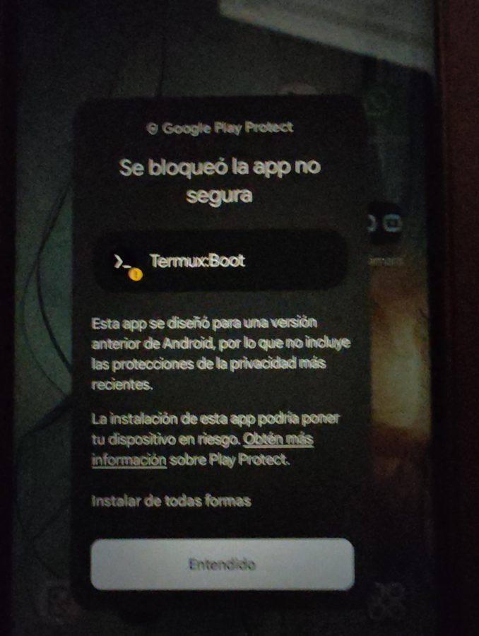
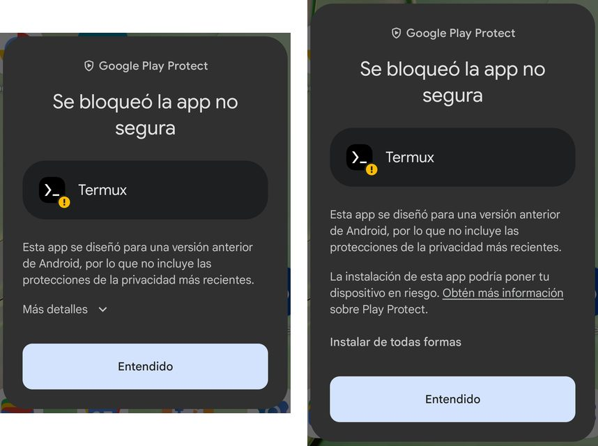
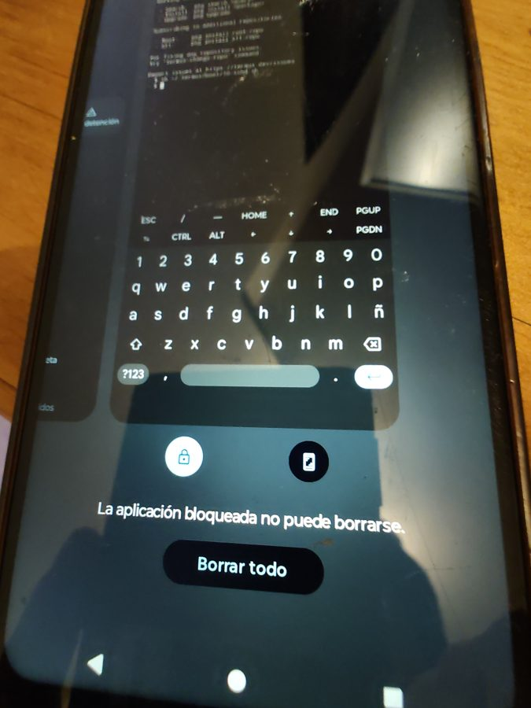

# Path A: server on stock Android (nothing erased)

`bash setup.sh` runs steps 0–8 for you; steps 9 to 12 are separate commands. This page explains what each step does, so you know what's
happening and can fix it if something goes wrong.

**Why "Path A"?** There are two ways to turn a phone into a server:

- **Path A** (this one): keep the phone's normal Android and add a Linux environment on top (Termux).
  No unlocking, no erasing, low risk. Limits: no "root" (admin) access, so programs can't use ports
  below 1024 (for example DNS on port 53), and you can't cap battery charging from software.
- **Path B**: unlock the bootloader and install a different system (like LineageOS) plus root. Full
  control, but it erases the phone, may void the warranty, and on some phones it's risky or impossible.
  See the notes for your device in [devices/](devices/).

Start with A. You can always go to B later.

---

## Step 0: look at the phone

`scripts/00-recon.sh` (read-only)

On the phone:

1. **Settings → About phone** → tap **Build number** 7 times. Enter your PIN. "You are now a developer!"
2. **Settings → System → Developer options** → turn on **USB debugging**.
   Developer options being on is *not* enough: USB debugging is a separate switch inside that menu.
3. Plug the phone into the computer. On the phone: **"Allow USB debugging?"** → check
   *Always allow from this computer* → **Allow**.

"File transfer" mode is not the same thing: it only lets the computer see files, like a USB stick.
`adb` needs USB debugging.

The script prints the model, Android version, RAM, storage and battery. If `adb devices` shows nothing,
toggle USB debugging off and on, tap **Revoke USB debugging authorizations**, and replug the cable.

A hand-me-down phone: remove the previous owner's Google account (Settings → Accounts) **before** a
factory reset, or after the reset it asks for their password and won't let you past setup.

### No USB cable: wireless debugging

If the phone's USB port is broken (or you have no data cable), steps 0–5 also work over Wi-Fi with
**Wireless debugging** (Android 11+). The phone and the computer must be on the same Wi-Fi.

1. **Developer options** → turn on **Wireless debugging** → tap its name → **Pair device with
   pairing code**. It shows an `IP:port` and a 6-digit code.
2. On the computer: `adb pair <IP:port> <code>`.
3. Back on the Wireless debugging screen, the `IP address & Port` at the top is a *different* port.
   Run `adb connect <IP:port>` with that one. `adb devices` should list the phone once.
4. Developer options → turn on **Stay awake**, so the screen doesn't lock while the steps run.
   Turn it off again after step 5: a screen that's always on heats the phone.

Wireless debugging turns itself off when the phone leaves the Wi-Fi or the screen locks for a
while, and the port changes each time. If a step says "No authorized phone", turn it back on and
`adb connect` the new port (no need to pair again). If it says "More than one phone", the same phone
got connected twice: `adb disconnect`, then `adb connect` once.

## Step 1: stop Android from killing background programs

`scripts/01-server-settings.sh` (undo with `--revert`)

Android is built for a phone in your pocket: it kills anything in the background to save battery.
A server must never sleep, so the script:

- turns off the **phantom process killer** (Android 12+ kills "child processes" of apps, and every
  program you run inside Termux is one of those). This is the same as *Developer options →
  Disable child process restrictions*.
- turns off **Adaptive Battery**, which freezes apps you don't open often.

## Step 2: install Termux

`scripts/02-install-termux.sh`

Downloads three apps from **F-Droid** (the free-software app store) and installs them:

| App | What it is |
|---|---|
| **Termux** | a terminal with a small Linux inside, where the server programs live |
| **Termux:Boot** | starts our server automatically when the phone turns on |
| **Termux:API** | lets scripts read battery level, temperature, etc. |

The Play Store version of Termux is old and abandoned. Always use F-Droid (or GitHub releases).
All three must come from the same place, or they refuse to talk to each other.

The script also removes the three apps from battery optimization.

### About the Play Protect warning

You will see this three times (photo from a phone set to Spanish):



> **Blocked unsafe app.** *This app was built for an older version of Android and doesn't include the
> latest privacy protections.*

Tap the small **"Install anyway"** text. The big **"Got it"** button *cancels* the install.

On newer phones "Install anyway" is hidden: tap **"More details"** first, and it shows up under it
(left: before, right: after; Motorola Edge 40, Android 15):



**Why it appears:** Termux deliberately targets an older Android version, because newer Android
versions forbid apps from running programs they download (and running programs is exactly what
Termux is for). Play Protect flags *that*, not a virus. Termux is open source and the APKs come
straight from f-droid.org.

## Step 3: SSH

`scripts/03-setup-ssh.sh`

**SSH** lets you type commands on the phone from your computer's keyboard, as if you were sitting at it.

1. Creates a key pair on your computer (`~/.ssh/drawer_server_ed25519`). Think of it as a
   key-and-lock set: the computer keeps the key, the phone gets the lock.
2. Copies the lock (public key) and `termux/bootstrap.sh` to the phone's `Download/drawer-server/` folder.
3. Opens Termux and **types** `bash /sdcard/Download/drawer-server/bootstrap.sh` for you.
   **Leave the phone unlocked and on Termux.** The first launch unpacks Linux, so the script waits ~25 s.
4. Inside the phone, the bootstrap installs `openssh`, trusts only your key (password login is off),
   holds a *wake lock* so the CPU doesn't sleep, and creates `~/.termux/boot/10-sshd.sh` so SSH comes back after a reboot.
5. Tests SSH through adb (the USB cable, or wireless debugging).

Termux's SSH listens on port **8022**, not 22, because ports under 1024 need root.
The Termux username looks like `u0_a123`; it gets saved in `local/phone.env`.

You'll see a permanent notification "Termux: wake lock held". That's how you know it's awake.

## Step 4: home network

`scripts/04-network.sh`

Tests SSH over Wi-Fi (no cable) and tells you what to put in your router so the phone always gets the
same address. That's a **DHCP reservation**: the router hands out addresses like a coat check, and the
reservation tells it "this phone always gets ticket 50".

On a **TP-Link Archer AX23** (tested): *Advanced → Network → DHCP Server → Address Reservation → Add*, type the MAC in the six boxes and the IP, then press **Tab** (the SAVE button stays grey until the IP field loses focus).

About the MAC address: Android invents a different one for each Wi-Fi network (privacy feature).
On many phones it stays the same for *your* network, but some (Motorola Edge 40, Android 15) change
it now and then, and the reservation stops matching. If the script warns that the MAC is made up,
the safe choice is: on the phone, **Wi-Fi → your network → Privacy** (or *MAC type*) → **Use device
MAC**, then run step 4 again and reserve the MAC it shows.

Weak signal (below about −75 dBm) means a flaky server. Move the phone closer to the router.

## Step 5: Tailscale (access from anywhere)

`scripts/05-tailscale.sh`

From outside home, the usual trick is "open a port on the router". That doesn't work on **Starlink**
and many mobile/fiber providers, because they put lots of homes behind one public address (**CGNAT**),
so nobody outside can reach yours directly.

**Tailscale** creates a private network between your devices that works from anywhere, and it's free
for personal use. The script opens the Play Store for you. Install it, log in, and accept the VPN
permission. Then install Tailscale on your computer or other phone with the same account.

The script also sets Tailscale as the **always-on VPN**, so it reconnects after a reboot. The phone needs a Google account signed in to install from the Play Store.
**Then turn off key expiry**, or the server drops out of Tailscale after 180 days and someone has to
log it in again by hand: on [login.tailscale.com/admin/machines](https://login.tailscale.com/admin/machines),
open the **…** menu on the phone's row → **Disable key expiry**.

If **Log in** does nothing, the phone has no web browser for the login page. Bring Chrome back with
`adb shell cmd package install-existing com.android.chrome` (running `extra-debloat.sh` again does
it too; older versions of it removed Chrome).

**After step 5 the server is done.** Steps 6–12 add things to do with it. They work over Wi-Fi, so
you can unplug the cable, and each one is optional. They read their settings from `.env`
(copy `.env.example` to `.env`; each section there says which step uses it).

---

## Step 6: ad blocking for the whole home (optional)

`scripts/06-nextdns.sh`, needs `NEXTDNS_LINK_URL` in `.env` (skips itself without it)

Blocks ads and trackers on every device at home, including TVs and the kids' tablets.
The blocking runs in [NextDNS](https://nextdns.io)'s cloud, because without root Android won't let
the phone answer DNS on port 53, the only port home routers use for it. What the phone does is keep
NextDNS up to date with your home's public IP, which changes often on Starlink and other CGNAT
connections.

1. Create a free account at my.nextdns.io. In **Setup → Linked IP → Show advanced options**, copy the
   URL that looks like `https://link-ip.nextdns.io/…/…` into `.env` as `NEXTDNS_LINK_URL`.
2. Run the script.
3. In your router's DHCP settings, set primary DNS `45.90.28.40` and secondary `45.90.30.40`
   (the script prints them too).

The free plan covers 300,000 queries a month. A busy home can go over that; NextDNS's dashboard shows
how much you use. To undo, remove those two DNS servers from the router.

## Step 7: game server for the kids (optional)

`scripts/07-luanti.sh`, needs `LUANTI_ADMIN` in `.env` (skips itself without it)

[Luanti](https://www.luanti.org) with the Mineclonia game: free, open source and plays like
Minecraft. It runs inside a small Debian on the phone and uses ~300 MB of RAM. Put the player name
that will be the game's admin in `.env` as `LUANTI_ADMIN` (yours or a kid's). The first run takes a
few minutes. Players install Luanti (free on Android, Windows, macOS and Linux), pick **Join Game**
and type the server's IP and port `30000` (the first time, **Register** instead of Join). The world
starts in survival; `LUANTI_CREATIVE=true` turns it into creative (unlimited blocks, flying, no
dying, no monsters); players who had already joined need the admin to type `/grant <name> fly, fast`
in the game chat to fly. `LUANTI_GAME=minetest` switches to Minetest Game, and `LUANTI_WORLD` picks
the world folder in `~/luanti/worlds` (a new name starts a new world). A world keeps the game it was
made with, so to switch games set a new `LUANTI_WORLD` too (the step refuses otherwise). Re-run the step after
changing any of these; the other worlds stay on the phone. A world made on a newer Luanti client
(5.12+) may not open on the server's Luanti 5.10: its map uses a newer database layout. Details in [services.md](services.md#luanti-notes-from-the-test).

## Step 8: status panel

`scripts/08-panel.sh`, optional `PANEL_*` settings in `.env`

A web page with the server's health and, if you want, your home's: internet, who's home, devices
on the Wi-Fi, printer ink. Open `http://<server-ip>:8080`. How to set up each card: [panel.md](panel.md).

## Step 9: photo backup from the family's phones (optional)

`bash scripts/09-syncthing.sh <name>`, once per person, with their phone at hand. Use the same name
as in the panel's `PANEL_PEOPLE` (same capitals; letters, numbers, - or _) so the backup shows under that person.

Each family phone sends its camera folder to the server over the home Wi-Fi with
[Syncthing](https://syncthing.net). The server keeps every photo, even after it's deleted on the phone.

**Before the first run,** give Termux access to the phone's storage: open Termux on the server,
type `termux-setup-storage`, press Enter and tap **Allow**.

The script shows a QR code. On the *family* phone, install **Syncthing-Fork** (Play Store or F-Droid),
scan the code and share the camera folder as **Send Only**. Photos land in `Backups/<name>/` on the
server. More in [services.md](services.md#photo-backup-notes-from-the-test).

## Step 10: charge between 30 and 80% with a smart plug (optional)

`scripts/10-smart-plug.sh`, needs `TUYA_*` in `.env`

A phone plugged in at 100% all day wears its battery out, and without root Android can't stop
charging by itself. A cheap Wi-Fi plug that works with the **Smart Life** app (Tuya) can: the
panel turns it off at 80% and back on at 30%.

You need, once: the plug paired in Smart Life with the phone's charger plugged into it, and a free
developer project at iot.tuya.com to get the plug's local key. The top of the script lists every
click. After that the phone talks to the plug over the home network only, so give the plug a
fixed IP in the router (like the server in step 4). The window can be changed with `CHARGE_LOW` and
`CHARGE_HIGH` in `.env`, then re-running step 8.

## Step 11: security cameras in the panel (optional)

`scripts/11-cameras.sh`, needs `PANEL_CAMERAS` in `.env`

At home, the panel shows a still of each camera that refreshes every few seconds (~4 s on the tested cameras); tap one for live
video, with ◀ ▶ to change camera and pinch to zoom. No cloud, no vendor app. Away from home the
card says "home only": keep using the camera's own app there.

You need cameras that speak RTSP (tested: Ezviz H8c; Hikvision works the same), each with a fixed
IP in the router. In `.env`: `PANEL_CAMERAS="Front=192.168.1.50:ABCDEF,Back=192.168.1.52:GHIJKL"`;
for Ezviz the code is the verification code on the camera's sticker. The step installs
[go2rtc](https://github.com/AlexxIT/go2rtc) (pinned version, checksum checked), which connects to
each camera once and only listens on the phone itself.

At home, open the panel by its Wi-Fi address (`http://<phone-ip>:8080`), not the Tailscale one, or
the cameras show as "home only". There's no login: anyone on the home Wi-Fi can open the panel and
watch, so give visitors the router's guest network. The video is H.265: phones, tablets and Chrome
on computers usually play it, some browsers don't. A screen too weak for the big stream drops to
the small one by itself.

## Step 12: motion recording (optional)

`scripts/12-recorder.sh`, needs step 11 and `RECORDER=yes` in `.env`

Step 11 lets you *watch* the cameras at home. This step *records*: when something moves, the phone
saves a short clip, with a few seconds from before the movement. The clips stay on the phone, and you
watch them in the panel's **Recordings** section, at home only. No cloud.

**It is off by default.** If your cameras already record to a memory card, you may not need it. Turn it
on by putting `RECORDER=yes` in `.env` and running `bash scripts/12-recorder.sh`. Turn it off by taking
that line out and running the script again: it stops the recorder and keeps your clips.

How it works, in short: the phone looks at each camera's small stream to see if the picture changes.
When it does, it saves the camera's full-quality stream as it comes, **copied, never re-encoded**. A
clip is at most 5 minutes long; if the movement goes on, the next clip carries on without a gap. There
is no sound.

**Settings** (all in `.env`, all optional; re-run step 12 after changing one):

| Setting | What it does | Default |
|---|---|---|
| `RECORD_CAMERAS` | which cameras record, by the names in `PANEL_CAMERAS`, comma separated | all of them |
| `RECORD_BEFORE` | seconds kept from before the movement, 0 to 30 | 5 |
| `RECORD_AFTER` | seconds recorded after the movement stops, 2 to 60 | 10 |
| `RECORD_SENSITIVITY` | 1 (only big changes) to 10 (small changes too) | 5 |
| `RECORD_CHECK` | `fast` looks at the picture twice a second; `light` looks only at full frames (about every 4 s on the tested cameras) and uses less CPU, but can miss a quick movement | `fast` |
| `RECORD_OBSTRUCTED` | what to do when a camera looks covered: `keep` recording or `pause` that camera until it clears | `keep` |
| `PANEL_RECORDINGS` | `no` hides Recordings in the panel (step 8) | shown |
| `DISK_RECORDINGS_GB` | most room the clips may use (step 8) | 10% of the phone's storage |
| `DISK_KEEP_FREE_GB` | free space the recorder keeps; below it the recorder deletes its oldest clips first, and stops making new clips only when none are left (step 8; at least 1) | 5 |

**"5 seconds before" is really 5 to 9.** A clip can only start at a *full frame* (a complete picture the
camera sends every few seconds, about 4 s on the tested cameras), so it starts at the first full frame
that is at least `RECORD_BEFORE` seconds back. The end works the same way.

**Where the clips are.** On the phone, in Termux's private storage:
`~/recordings/<camera>/<YYYY-MM-DD>/`, one `.mp4` per clip and a small `.jpg` thumbnail next to it. The
file name is the start time and the length in seconds (`143015-42.mp4` = 14:30:15, 42 s). Other apps can't
see this folder. To copy clips to your computer, use SFTP on port 8022, with the same login as SSH from
step 3 (WinSCP and FileZilla work).

**When the space is full,** the oldest clips are deleted first, across all cameras, until the folder is
under `DISK_RECORDINGS_GB`. That is normal and the panel doesn't warn about it. The recorder only ever
deletes its own clips, never photos or anything else. The panel never deletes or changes anything. To
delete clips yourself: SFTP, or ssh into the phone and run `rm -r ~/recordings/<camera>/<day>` (or
`rm -r ~/recordings` for all of them).

**A camera that sees something moving all the time** (a plant in the wind, a flag, rain on the lens) would
fill the clips folder with useless clips and write to the phone's storage all day. For those cameras use
`RECORD_OBSTRUCTED=pause`: when a camera sees movement in more than half of its looks over 10 minutes (it clears under a quarter), or its picture
goes black or flat for about a minute (something on the lens; a camera without night vision does this every
night), the panel's top line says **"⚠️ Front looks obstructed, check it (still recording)"**, or
**"(recording paused)"** with `pause`. The warning clears by itself: the movement one when it falls under a quarter of the looks over 10 minutes, the black or flat one after about a minute of normal picture. With
`pause` the camera still watches, so it starts recording again when things calm down.

### Heat and load: read this before leaving it on

The recorder keeps the phone busy around the clock, because it reads every camera all the time. The phone
runs **warmer** than with the other services, more so in a closed drawer or while charging.

- Watch the panel's 🌡️ card. The top line warns at 40 °C.
- Give the phone some air: don't leave it in a closed drawer, and don't cover it.
- If it runs hot, use `RECORD_CHECK=light` or record fewer cameras (`RECORD_CAMERAS`).
- Check after the first day, not just the first hour.

<!-- TASK12: heat numbers (measured temperature curve with the recorder on, with the phone named) -->

**Measured on the Motorola Edge 40** (8 GB, fast chip, server on 5 GHz Wi-Fi), three cameras at once,
in each mode, without the recorder's own Python program (about 0.2% of a core and 20–30 MB more):

| | `light` | `fast` (default) |
|---|---|---|
| CPU, of one core (the phone has 8) | about 38% | about 66% (about 8% of the whole phone) |
| of which one camera's motion check | 3.1% | 12.3% |
| of which go2rtc relaying the streams | about 21% | about 21% |
| RAM | about 370 MB | about 400 MB |

The cameras' video adds about 7 Mbit/s over the server's Wi-Fi. On the **Moto G24 Power** (slower chip,
2.4 GHz Wi-Fi) these are estimates from one camera, not measured with three: about 25–30% of a core
in `light` mode and about 60–65% in `fast` mode, and about 260 MB of RAM.

**Your phone may differ.** These numbers belong to those phones and those cameras.

- *The phone:* the chip (an older one can cost twice as much per camera), the RAM, the size of the disk
  (and so the default room for clips), the Wi-Fi band and signal, and how well it gets rid of heat.
- *The cameras:* how often they send a full frame (changes how long "5 s before" really is and how often
  `light` mode looks), their bitrate (the size of each clip and the Wi-Fi load) and the frame rate of their small
  stream (lower it in the camera's own settings and `fast` mode costs less).
- *The scene:* the more movement, the more is written.

To check your own: open the panel's **🖥️ section** (temperature, free memory) a few hours after turning it
on, or ask Claude to run the `check-server` skill. If the numbers are too high, use `light` mode or fewer cameras.

## Optional: free some RAM

`scripts/extra-debloat.sh` (undo with `--revert`)

Hides preinstalled apps the server doesn't need (Facebook services, games, YouTube…). It keeps
Chrome, because Tailscale's login needs a browser. On the test
phone this freed ~0.8 GB of RAM, and `--revert` brings it all back. Run it without options:
the script also has a `--user-apps` option that **erases** the apps you installed and their data,
can't be undone, and is not part of Path A.

---

## If the server stops ("Connection refused")

Android lets *you* force-stop any app, and no app can survive that: tapping **Force stop** in
Termux's app info, or **Clear all** in the recent-apps screen on some phones (Motorola included),
kills Termux until it is opened again. To avoid it, **lock Termux in recents**: open the
recent-apps screen (■ button), and on Motorola tap the **padlock** under the Termux card.
It confirms with *"A locked app can't be cleared"*, and "Clear all" skips it from then on.

The other way to stop it by accident is the **Exit** button on Termux's notification: it closes every
Termux session, and a few minutes later Android cleans up the rest of the server. If other people use
the phone, tell them to leave Termux's notification alone.



Don't confuse it with **screen pinning** ("App pinned", unpin by holding Back + Recents): that
traps the phone inside Termux and blocks the scripts from opening other apps. It can be a nice
"kid lock" once the server is finished, but leave it off while setting things up.

To bring it back, just **open Termux**: its startup restarts the server. From the computer, with
the cable plugged in (or [wireless debugging](#no-usb-cable-wireless-debugging) on) and the phone unlocked:

```bash
bash scripts/restart-server.sh
```

You don't need the screen always on: Termux's wake lock keeps the processor running with the
screen off, and a screen that's always on heats the phone, which is bad for the battery.

## Moving to a new phone

`scripts/move-server.sh` (nothing is erased on either phone)

When a better phone comes along, the new one takes over with everything the old one had: photos,
game worlds, settings, smart plug, Syncthing's identity (the family's phones reconnect by
themselves), the same home address and the same Tailscale address. Nobody else changes anything.
Step by step: **[docs/new-phone.md](new-phone.md)**.

## Undoing everything

If you set up the smart plug (step 10), first turn it on in the Smart Life app, or plug the
charger straight into the wall: once Termux is gone, nothing turns the plug back on.

```bash
bash scripts/01-server-settings.sh --revert       # Android's background-killing settings
bash scripts/extra-debloat.sh --revert            # only if you ran it: brings back preinstalled apps
adb shell settings delete secure always_on_vpn_app
adb uninstall com.termux.boot && adb uninstall com.termux.api && adb uninstall com.termux
```

Uninstalling Termux deletes everything inside it (the services from steps 6–12, the game world, the
recorded clips, the panel's history) but **not** the photo backups, which live in the phone's storage under `Backups/`.
Then remove the router reservation, the NextDNS DNS servers from the router if you set them, and
Tailscale if you want.
